# Jagadish-finance-bank-in-a-box

Multi-agent "bank in a box": three specialist agents — investment
analysis, risk assessment, compliance review — that collaborate through
an orchestrator to produce a comprehensive financial decision memo,
with dissent recorded, failures visible, and a human checkpoint before
any memo goes final.

**Fictional firm:** Merrowgate Financial (invented for this repo; see
`docs/purpose.md` for how the name was chosen). **All data is
synthetic.** This is an independent portfolio project: it is not
affiliated with, endorsed by, or connected to any university, training
provider, bank, or financial institution. Nothing here is real
financial advice for any real person.

## Recruiter summary

- **Problem:** a single agent writing a financial decision memo blends
  return-chasing, risk worry, and rule-checking into one voice — and a
  failed agent silently disappears from the evidence.
- **Approach:** three specialists with least-privilege database views,
  an orchestrator that resolves conflicts with a documented veto rule
  (compliance BLOCK beats investment enthusiasm), and human checkpoints
  before any memo goes final.
- **Proof (real runs):** 53 tests green with system `python3 -m pytest`
  (stdlib only, no virtualenv); every enforcement claim below names
  the test that proves it; the demo memo for synthetic customer
  CUST-001 renders three findings and an APPROVE recommendation.

## Architecture

```mermaid
flowchart TD
    U[Human reviewer] --> O[Orchestrator]
    O --> I[Investment agent<br/>tools: v_positions]
    O --> R[Risk agent<br/>tools: v_positions, v_transactions]
    O --> C[Compliance agent<br/>tools: v_transactions, v_customers]
    I --> A[SQLite authorizer<br/>views only, writes denied]
    R --> A
    C --> A
    A --> V[(Views)]
    V --> B[(Base tables<br/>never directly readable)]
    I --> M[Decision memo<br/>DRAFT]
    R --> M
    C --> M
    M --> G[Confirmation gate + named approval]
    G --> F[FINAL memo]
```



## How it works, step by step

1. Build the store: base tables seeded with synthetic rows, masked
   views created, authorizer installed last.
2. Orchestrator divides the proposal into three tasks and delegates
   one per specialist, recording each assignment.
3. Each agent reads only its views. Direct base-table reads raise at
   the database boundary.
4. A failing agent is contained: its failure is recorded in the memo,
   surviving findings stand, the memo is stamped partial.
5. Stances resolve by precedence (BLOCK → REJECT → CONDITIONAL →
   APPROVE); dissent is kept in its own memo section.
6. The memo stays DRAFT until a confirmation gate passes on an
   unambiguous, confident "yes" AND a named, single-use, scoped,
   unexpired approval is consumed for exactly that memo.
7. Email notification dry-runs by default; sending needs explicit
   opt-in, a non-CI environment, and an injected transport (none
   shipped).

## Real output

Command: `python3 -m bank_in_a_box.demo` (actual output):

```
DECISION MEMO MEMO-001 — customer CUST-001
Status: DRAFT
Recommendation: APPROVE

Findings:
 - [investment] APPROVE: Portfolio value 200000.00 against cost 182000.00; net 18000.00.
 - [risk] APPROVE: No concentration flag: largest holding 60% of portfolio value.
 - [compliance] APPROVE: All screened transactions clear; no disclosure gaps found in the synthetic record.
```

Full excerpts, the veto-scenario output, and the test-run output are
in `docs/code-excerpts.md`.

## How to run (offline first)

```bash
python3 -m bank_in_a_box.demo
python3 -m bank_in_a_box.demo --finalise --approver "Ada Reviewer"
python3 -m pytest tests/ -q
python3 scripts/check_overlap.py /path/to/source.txt
```

Requirements: Python 3.11+ and `pytest`. No third-party packages, no
network, no credentials, no virtualenv inside the repo. There is no
deployment target, no hosted service, and no package release — none
claimed.

## Guardrails — every claim names its proof test

| Claim | Proof test(s) |
|---|---|
| View-only reads; base tables + `sqlite_master` denied | `test_direct_base_table_read_denied`, `test_sqlite_master_read_denied`, `test_view_read_allowed` |
| Writes / PRAGMA / ATTACH / load_extension denied | `test_insert_denied`, `test_update_and_delete_denied`, `test_pragma_denied`, `test_attach_denied`, `test_load_extension_function_denied` |
| Authorizer tests assert behaviour, never message text | `tests/test_authorizer.py` (see header) |
| Gate: bypass / reject / absent paths blocked | `test_finalise_without_gate_raises_not_evaluated`, `test_gate_rejects_explicit_no`, `test_gate_absent_consent_denied` |
| Gate: low confidence + self-contradicting consent blocked | `test_gate_low_confidence_denied`, `test_gate_self_contradicting_consent_denied`, `test_gate_yes_but_no_denied` |
| Approvals: named, single-use, scoped, expiring | `test_approval_anonymous_rejected`, `test_approval_single_use`, `test_approval_wrong_scope_rejected`, `test_approval_expired_rejected` |
| PII redaction incl. cards + emails | `test_redact_card_number`, `test_redact_email_address`, `test_redact_phone_and_ssn` |
| Row cap at fetch time (`fetchmany(MAX+1)`, no `LIMIT` rewrite, no `fetchall`) | `test_row_cap_exceeded`, `test_row_cap_boundary_ok`, `test_no_fetchall_in_package_source` |
| Negative costs rejected | `test_negative_cost_rejected`, `test_zero_cost_ok_and_nan_rejected` |
| Brand blocklist non-empty + detecting | `test_brand_blocklist_non_empty`, `test_brand_blocklist_detects_blocked_phrase` |
| Email dry-run default, refused in CI | `test_email_dry_run_by_default`, `test_email_refused_in_ci`, `test_email_opt_in_without_transport_refused` |
| Loop / delegation-conflict / cascade handling | `test_loop_detection_quarantines_agent`, `test_delegation_conflict_detected`, `test_cascading_error_contained_not_poisoning` |
| Compliance veto beats investment enthusiasm | `test_compliance_veto_beats_investment_enthusiasm` |
| Dissent recorded, checkpoint before FINAL | `test_dissent_recorded_not_hidden`, `test_checkpoint_blocks_finalise_without_human`, `test_finalise_with_gate_and_named_approval` |

Full table: `docs/guardrails.md`. Limitations kept visible:
`docs/limitations.md`.

## Built vs planned

| Item | Status |
|---|---|
| Three specialist agents + orchestrator + veto rule | Built |
| Loop / conflict / cascade handling; memo with dissent + failures | Built |
| Human checkpoints; authorizer; redaction; row cap; cost rules; brand check; email dry-run | Built |
| Offline demo + 53-test suite; `knowledge/` notes + Mermaid docs | Built |
| Live-model agents behind the Finding schema | Written-not-run (design in `docs/implementation-guide.md`) |
| Persistent DB + audit log; verified-identity approvals | Planned |
| CI workflow, CodeQL, Dependabot, branch rulesets | Planned (at push time; no `.github/` in this scaffold) |
| Deployment / hosted service / package release | Planned — none claimed |

## Docs (the 13-item checklist)

- Recruiter summary: `docs/recruiter-summary.md` (also above)
- Purpose: `docs/purpose.md`
- Architecture: `docs/architecture.md`
- How it works: `docs/how-it-works.md`
- Real code excerpts + output: `docs/code-excerpts.md`
- How to run: `docs/how-to-run.md`
- Guardrails: `docs/guardrails.md`
- Limitations: `docs/limitations.md`
- Built vs planned: `docs/built-vs-planned.md`
- Implementation guide: `docs/implementation-guide.md`
- Interview points: `docs/interview-points.md`
- Threat model + ADRs: `docs/threat-model.md`
- Related repos: `docs/related-repos.md`
- Distilled notes + Mermaid architecture: `knowledge/`

## Licence and security

MIT — see `LICENSE`. Security policy and reporting: `SECURITY.md`.
