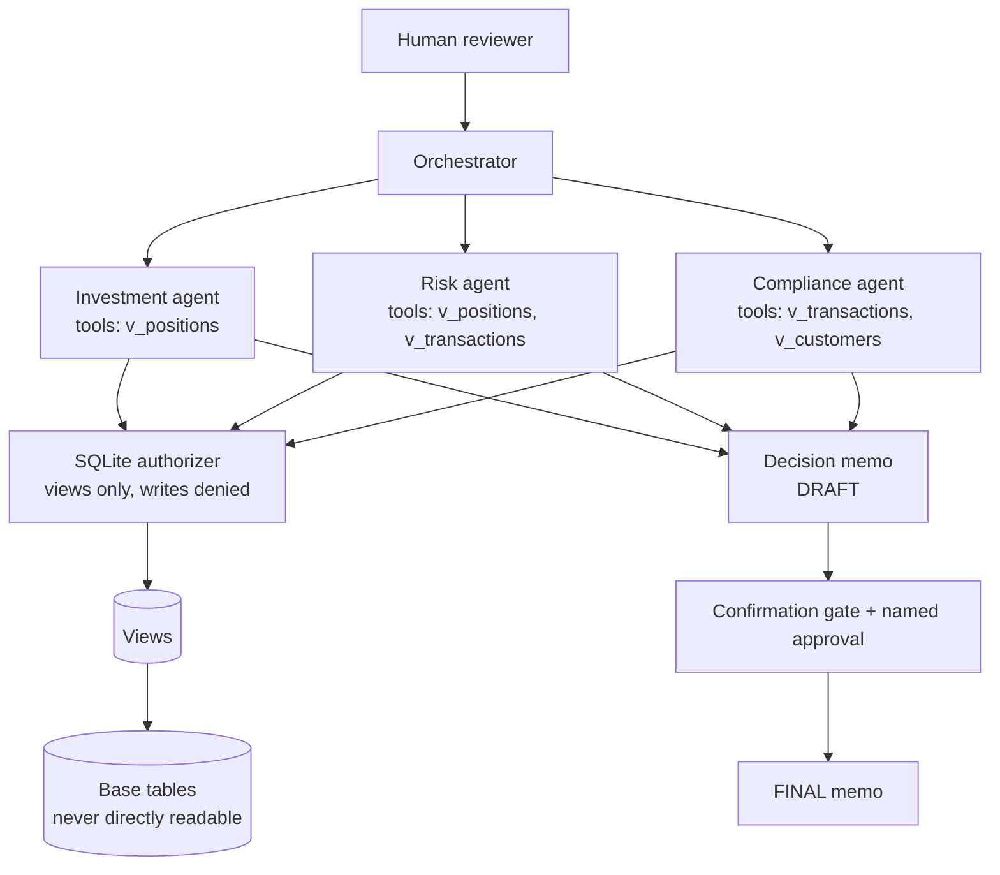

# Architecture

See `knowledge/` for the same diagrams with failure-handling and
oversight flows drawn separately.

## Components

| Component | File | Job |
|---|---|---|
| Authorizer | `bank_in_a_box/authorizer.py` | View-only reads, writes/PRAGMA/ATTACH/load_extension denied |
| Store | `bank_in_a_box/store.py` | Synthetic seed, masked views, capped fetch |
| Agents | `bank_in_a_box/agents.py` | Three specialists, one Finding schema each |
| Orchestrator | `bank_in_a_box/orchestrator.py` | Divide, delegate, loop/conflict/cascade handling, veto |
| Memo | `bank_in_a_box/memo.py` | DRAFT → FINAL, dissent + failures sections |
| Gates | `bank_in_a_box/gates.py` | Consent evaluation: present, unambiguous, confident |
| Approvals | `bank_in_a_box/approvals.py` | Named, single-use, scoped, expiring |
| Redaction | `bank_in_a_box/redaction.py` | Cards, emails, phones, SSN-shaped strings |
| Budget | `bank_in_a_box/budget.py` | Cost inputs reject negatives |
| Brand | `bank_in_a_box/brand.py` | Hashed blocklist check |
| Notify | `bank_in_a_box/notify.py` | Email dry-run by default, refused in CI |

## The conflict rule (the one decision that matters most)

Precedence, highest first: compliance **BLOCK** → REJECT; any
**REJECT** → REJECT; any **CONDITIONAL** → CONDITIONAL; otherwise
**APPROVE**. The losing views are not deleted — they appear under
"Dissent (recorded, not hidden)" in the memo. A test with an
enthusiastic investment agent and a blocking compliance agent proves
the veto wins (`test_compliance_veto_beats_investment_enthusiasm`).
