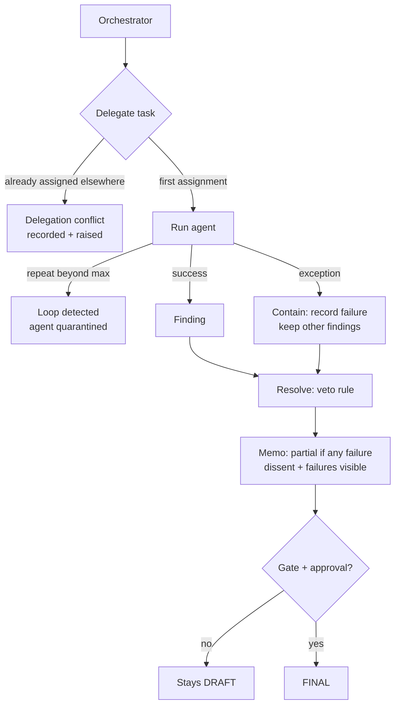

# Knowledge — failure handling architecture

## The three failure modes, and what "handled" means here

1. **Loop** — same agent, same task, too many runs. Handled means
   stopped and named, not retried forever.
2. **Delegation conflict** — same task, two owners. Handled means the
   second assignment is refused and the clash is written into the
   memo's conflict list, not resolved by last-writer-wins.
3. **Cascade** — one agent throws. Handled means the memo still forms
   from the survivors, is stamped partial, and carries the failure
   reason in its own section. "Handled" never means "hidden".
