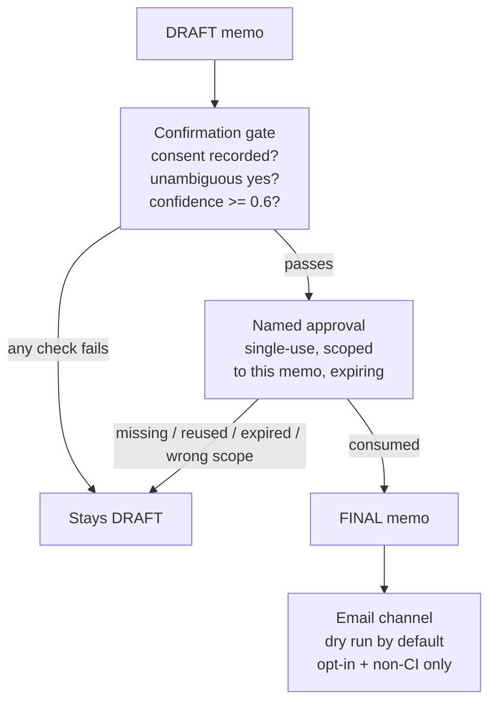

# Knowledge — human oversight architecture

## Why two checkpoints instead of one

The gate answers "did a human actually say yes, clearly, just now?"
The approval answers "who said it, for this exact memo, and is it
still valid?" A gate without an approval is anonymous; an approval
without a gate could be a stale signature waved at a new memo. Both
must pass, in that order, and the approval is consumed — one approval,
one finalisation, ever.
