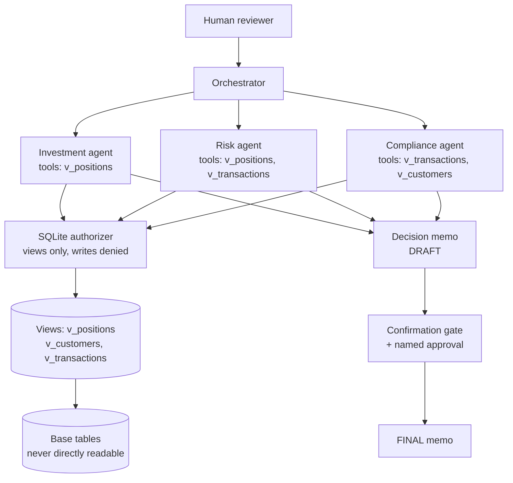

# Knowledge — architecture overview

## Why this shape

- One orchestrator, three lenses: the division mirrors the decision,
  not the org chart. Each agent owns exactly one question.
- Views as the contract: an agent's tools list names views, and the
  authorizer enforces the list at the database boundary.
- Memo as the only shared artefact: agents never message each other
  directly, so a failure in one cannot corrupt another's output — the
  orchestrator is the only writer, and it records failures verbatim.
